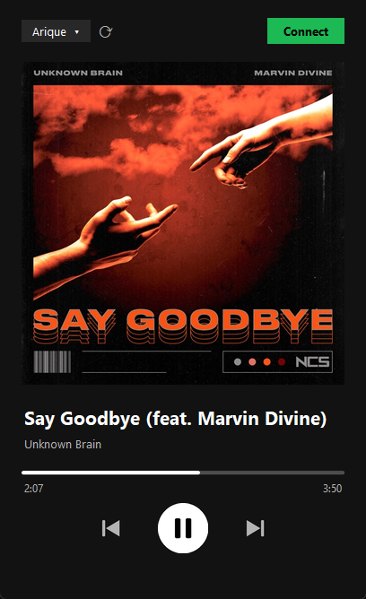

# Bluetooth Receiver

Turn a Windows laptop into a Bluetooth speaker for your iPhone, with a Spotify-style now playing screen.



- **Audio**: iPhone audio plays through the laptop speakers (Bluetooth A2DP).
- **Now playing**: song title, artist and a live progress bar.
- **Controls**: play / pause, next, previous, all sent to the iPhone.
- **Album cover**: looked up on the iTunes catalogue and saved locally, so songs you've heard before show their cover offline too.

## Requirements

- Windows 10 (version 2004 or newer) or Windows 11, with Bluetooth
- Python 3.10+
- An iPhone paired with the laptop

## Install

```
pip install winrt-runtime winrt-Windows.Media.Audio winrt-Windows.Devices.Enumeration winrt-Windows.Devices.Bluetooth winrt-Windows.Devices.Bluetooth.GenericAttributeProfile winrt-Windows.Storage.Streams winrt-Windows.Foundation winrt-Windows.Foundation.Collections pillow
```

## Usage

```
python app.py
```

Use `pythonw app.py` (or a desktop shortcut pointing to it) to run it without a console window.

1. Pick your iPhone in the dropdown. Not there yet? Choose **+ Add device…** to pair it in Windows settings.
2. Click **Connect**.
3. Play music on the iPhone. Song info and controls show up a few seconds later.

## How it works

- **Audio** uses Windows' built-in Bluetooth audio receiver API (`AudioPlaybackConnection`).
- **Song info and controls** use Apple Media Service (AMS) over Bluetooth LE. The app advertises over BLE so the paired iPhone connects to it. It then reads the track info and sends remote commands. Windows doesn't expose the iPhone as a media session, so this is the only way to get them.
- **Album covers** come from the [iTunes Search API](https://performance-partners.apple.com/search-api) and are cached in `covers/`.

## Limitations

- Seeking isn't possible: AMS has no seek command.
- Album covers need internet the first time, and less common songs may not be found or may match the wrong album.
- Controls are tested with iPhone only. Android phones get audio but no song info or controls.
